  

  <b>Building intelligent systems at the intersection of AI, software and real-world problems.</b>

  

## 🧠 About Me

I'm a developer interested in building practical software solutions using **Artificial Intelligence, Machine Learning and Full-Stack Development**.

I enjoy turning ideas into working products, experimenting with emerging technologies, participating in hackathons and continuously improving my problem-solving skills. My work spans intelligent agents, LLM-powered applications, and full-stack systems, from APIs and databases to user-facing interfaces.

---

## 🛠️ Tech Stack

### 💻 Languages

  

### 🤖 AI / Machine Learning

  

**Exploring:**

`Artificial Intelligence` · `Machine Learning` · `LLM Applications` · `AI Agents` · `Generative AI`

### 🌐 Web Development

  

### 🧰 Tools & Platforms

  

---

## 🔨 Currently Building

🤖 AI-powered applications · 🧠 Intelligent AI agents · 🌐 Full-stack systems · 🚀 Turning ideas into working products

---

## 📚 Currently Learning

I'm working my way from **Artificial Intelligence** fundamentals through **Large Language Models**, **AI Agents**, and **Generative AI**, toward building production-ready AI systems. I'm particularly interested in understanding not just how AI models work, but how to turn them into useful, reliable applications.

---

## 🔥 Contribution Streak

  

---

## 🐍 Contribution Snake

  

---

## 💡 What I Like Building

<table>
<tr>
<td align="center" width="25%">

### 🤖
**AI Applications**

Intelligent systems powered by modern AI.

</td>
<td align="center" width="25%">

### 🧠
**AI Agents**

Systems that can reason, interact and perform tasks.

</td>
<td align="center" width="25%">

### 🌐
**Full Stack**

Complete applications from UI to backend.

</td>
<td align="center" width="25%">

### 🚀
**Experiments**

Turning ideas into working prototypes.

</td>
</tr>
</table>

---

## 🌱 Philosophy

Don't just learn technology. Understand it, build with it, break things, fix them, and build something better.

---

## 🤝 Let's Connect

  
  

  

